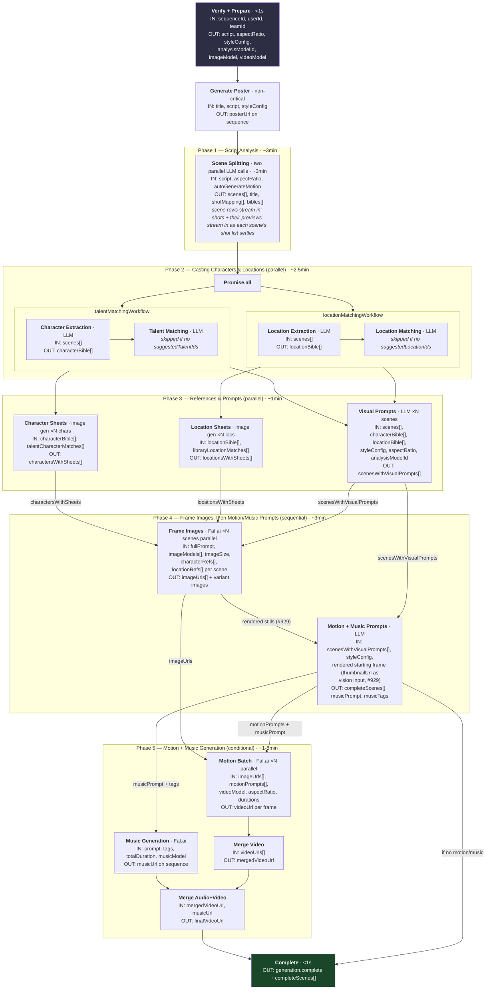
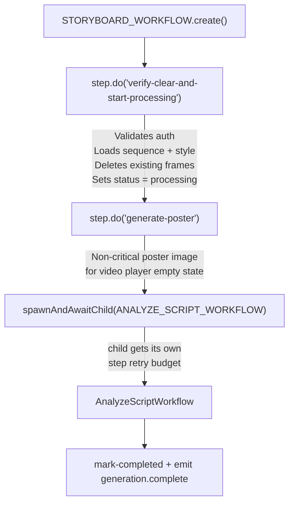
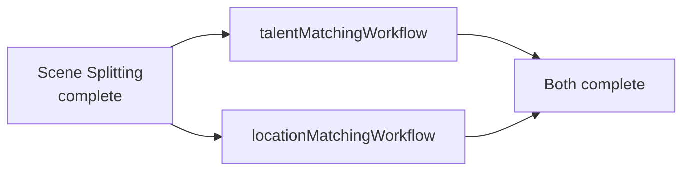
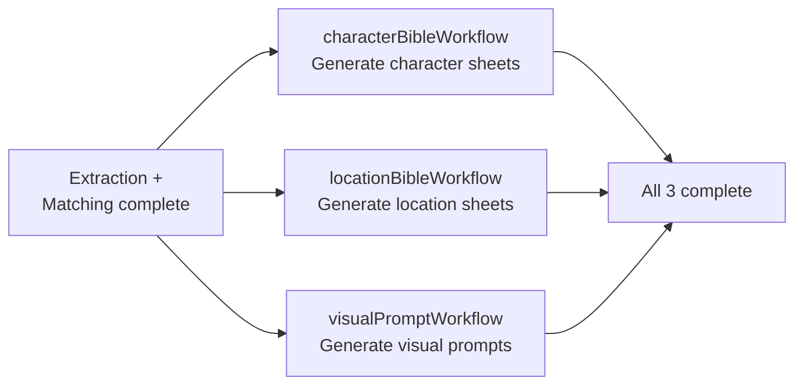
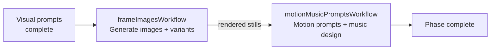
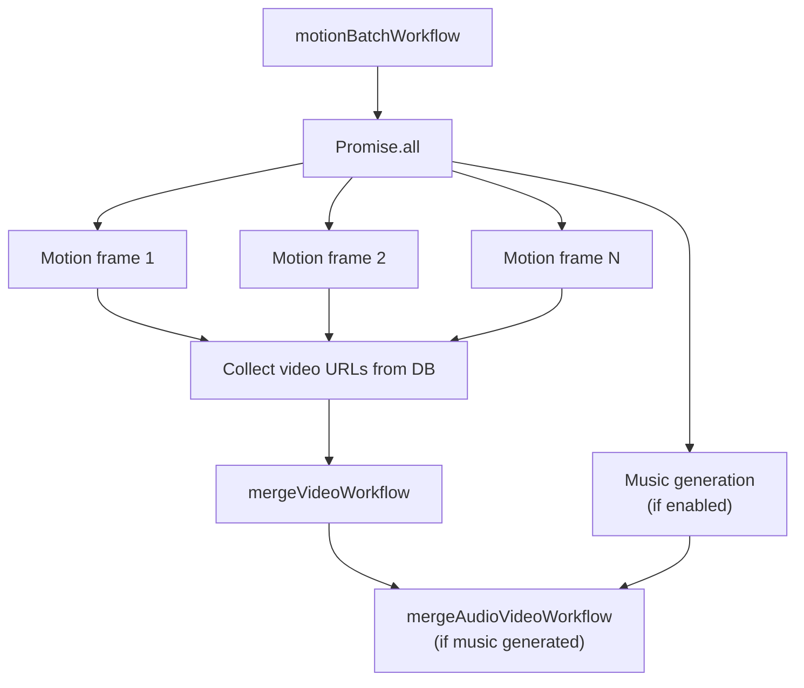
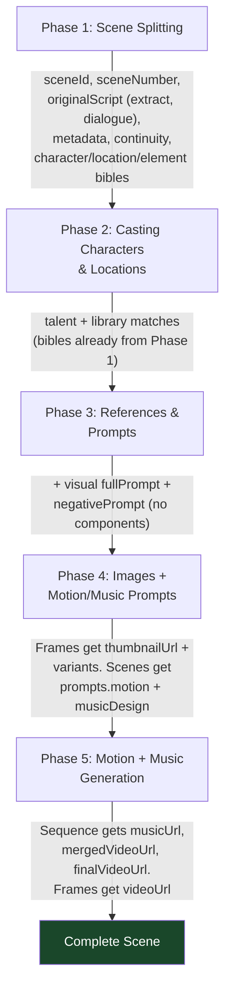

该端到端管道会将用户脚本转换为包含图像、动态视频和音乐的完整故事板。若要了解后续编辑会使哪些内容失效，请使用交互式[依赖关系图](/docs/dependency-graph)。

## 高层概览

> **计时来源：**基于本地 Cloudflare Workflows（通过 Miniflare 运行 Workerd）处理 9 个场景的实测数据。自 #929 起，阶段 4 改为**顺序执行**：先渲染帧图像，再生成动态/音乐提示词。这是因为动态提示词步骤依赖实际渲染出的起始帧（作为视觉输入传给 LLM）。该方案放弃了此前图像与提示词并行生成的方式，换取以图像为依据的动态效果。

## 触发流程

该管道由 `src/sequences/sequences.fn.ts` 中的服务器处理函数启动：

1. **`createSequenceFn`** — 创建新的序列记录，然后调用 `triggerWorkflow('/storyboard', input)`
2. **`updateSequenceFn`** — 如果脚本、样式、宽高比或分析模型发生变化，则触发同一工作流
3. **`retryStoryboardFn`** — 重试失败的序列（将状态重置为 `processing`，然后重新触发）

三者都使用 `src/platform/server/workflow/client.ts` 中的 `triggerWorkflow()`，该函数会：

- 通过 `TRIGGER_TO_BINDING`（`src/platform/server/workflow/trigger-bindings.ts`）解析触发路径对应的 **Cloudflare Workflows 绑定**，例如 `/storyboard` → `STORYBOARD_WORKFLOW`
- 调用 `binding.create({ id, params: body })` 在进程内启动持久工作流实例（本地使用 Workerd，与生产环境运行时相同，无 HTTP webhook，也无 QStash）。`options.deduplicationId` 会成为实例 ID，使触发操作具备幂等性
- 返回工作流实例 ID，并将其作为 `workflowRunId` 持久化到相关数据库行中，以便跟踪

**输入结构（`StoryboardWorkflowInput`）：**

| 字段                   | 类型      | 用途                                      |
| ---------------------- | --------- | ----------------------------------------- |
| `userId`               | string    | 身份验证上下文                            |
| `teamId`               | string    | 身份验证上下文                            |
| `sequenceId`           | string    | 目标序列                                  |
| `options`              | object    | `framesPerScene`、`generateThumbnails` 等 |
| `autoGenerateMotion`   | boolean   | 是否为每一帧生成视频                      |
| `autoGenerateMusic`    | boolean   | 是否为序列生成音乐                        |
| `musicModel`           | string?   | 覆盖音乐模型                              |
| `imageModels`          | string[]? | 用于并行生成的多个图像模型                |
| `suggestedTalentIds`   | string[]? | 为选角预先选定的演员                      |
| `suggestedLocationIds` | string[]? | 为匹配预先选定的地点                      |

## 故事板工作流

**文件：**`src/sequences/server/workflows/storyboard-workflow.ts`

故事板工作流（`StoryboardWorkflow`，一个继承 `OpenStoryWorkflowEntrypoint` 的 `WorkflowEntrypoint`）会验证数据、生成海报图像，然后委托给脚本分析工作流。每个工作单元都在 `step.do('name', …)` 中运行，以便 Workflows 引擎建立检查点并自动重试。

**步骤：`verify-clear-and-start-processing`**

1. 通过 `validateSequenceAuth()` 验证身份
2. 使用 `getSequenceForUser()` 加载序列，并检查脚本和样式是否存在
3. 加载并解析样式配置
4. 删除该序列的所有现有帧
5. 将序列状态设置为 `processing`
6. 返回解析后的模型：`analysisModelId`、`imageModel`、`videoModel`

**步骤：`generate-poster`**

- 根据脚本 + 标题 + 样式生成海报图像，用于视频播放器的空状态
- 非关键步骤，失败会被记录并忽略

**步骤：`upload-poster` → `save-poster`**

- `upload-poster` 将提供商图像流式传输到 R2（`uploadPosterToStorage`），因此存储的 URL 是相对于源站的 `/r2/` 路径，且永不过期（#1117）。该步骤同样非关键：上传失败时会回退到提供商 URL
- `save-poster` 将 `posterUrl` 写入序列，并发送包含该 URL 的 `generation.poster:ready`

随后通过 `spawnAndAwaitChild(ANALYZE_SCRIPT_WORKFLOW, …)`（`src/platform/server/workflow/await-child.ts`）生成 `AnalyzeScriptWorkflow` 子工作流并等待其完成。该子工作流作为独立的持久实例运行，并拥有自己的逐步骤重试预算。

脚本分析工作流完成后，将状态标记为 `completed` 并发送 `generation.complete`。

## 脚本分析工作流：逐阶段说明

**文件：**`src/sequences/server/workflows/analyze-script-workflow.ts`

这是核心编排工作流。它通过 `step.do()` 运行持久工作单元，通过 `spawnAndAwaitChild()` 生成子工作流，并使用 `Promise.all()` / `Promise.allSettled()` 并行扇出子工作流。输入读取自 `event.payload`，实例 ID 读取自 `event.instanceId`。

### 阶段 1：场景拆分（流式 LLM）

**子工作流：**`sceneSplitWorkflow`（`src/sequences/server/workflows/scene-split-workflow.ts`）

使用流式 LLM 输出，在场景到达时逐步创建场景行。只有当某场景的镜头列表条目落库后，镜头才会存在（#1593）；随后会为每个镜头生成预览图像并复制到 R2。

**步骤：**

自 #1035 起，拆分通过**两个并行 LLM 调用**执行（使用 `Promise.all` 的同级 `step.do`），两者都处理同一份带行号边栏的脚本副本，LLM 不会重新输出脚本文本。#1486 在切片生成后增加了第三个调用，使一个场景可以拥有 1..N 个镜头；自 #1585 起，该调用还会携带每句台词，因此 `originalScript.dialogue` 来源于此（切片正则仅用于流式预览）：

1. **`scene-splitting-stream`** — 场景调用，采用**边界注释**契约：模型返回 `boundaries[] = { hintLine, quote }`，`boundary-split.ts` 将每段逐字引文解析为原始偏移量（精确 → 规范化 → 模糊，使用单调游标），然后切分原始脚本。切片是字节级原样相邻子串（通过断言保证 `concat(slices) === script`）。数据流交由 `createStreamingSceneParser()` 处理：
   - 每个边界最终确定后：持久化场景行 + 拆分脚本版本，并发送 `generation.scene:new`。此时**不创建镜头行**（#1593）：在镜头列表条目落库前，轨道中会将该场景显示为“正在列出镜头…”
   - 检测到标题时：更新序列标题，并发送 `generation.updated`
   - 锚点修复过多时：携带反馈重试一次；若第二次结果仍有退化，则保留首次 LLM 生成的场景。被丢弃的边界会被记录，并作为非致命 `generation.error` 发送
   - 在同一地点/节拍内切分**不会**创建新场景（ONE SHOT RULE 已移除）
2. **`scene-bibles`** — 设定集调用：`{ characterBible[], locationBible[], elementBible[] }`。地点/元素的 `firstMention` 在传输结构中为 `{ text, lineNumber }`；服务端根据边栏行号推导其所属场景 ID。角色条目携带 `voiceOnly`（#1585）：旁白或画外音会创建行，但不生成设定图、不参与演员匹配，也不会进入静帧提示词。合并后，场景连续性标签会规范化为设定集标签（`tag-reconcile.ts`），因为两个独立调用可能产生分歧。
3. **`scene-shot-list-1..K`** — 在每个已解析切片中列出 1..N 个结构化镜头。场景按 **`SHOT_LIST_BATCH_SCENES`（8）个一批**发出，每批对应一个 `step.do`，所有批次并发执行（`Promise.all`）：粘贴一部长片脚本会产生十多个有界调用，而不是一次触及模型输出上限的调用；某一批失败时也只需单独重放该批。**每个调用都采用流式传输**（`runStructuredCall` + `onAccumulated`）：每累计 `PARSE_COALESCE_CHARS` 最多进行一次局部解析；每个已经稳定的场景条目（`settledPrefix`，即后续条目已开始或数据流已结束）都会立即通过 `persistSceneShots` 落库：更新插入场景行（通过 `orderIndex` 获得稳定 ID），分配镜头（`attachSceneShots`）并按 `(sceneId, shotNumber)` 更新插入，使用 `deleteFromShotNumber` 清除尾部行，为每个镜头发送 `generation.shot:created`，并为每个镜头触发预览。场景包含 2 个以上镜头时使用镜头规格文本，否则使用切片（通过 `triggerWorkflow` 触发后不等待；按实例 + 镜头去重，因此步骤重放具备幂等性；图像工作流将预览复制到 R2，并记录为 `kind: 'preview'` 变体）。数据流中途的条目只按 `sceneNumber` 匹配；验证后的最终载荷才是权威结果。若遗漏场景，`attachShotLists` 会抛出错误，并负责落库数据流未处理的任何内容（例如位置匹配，或提供商没有发送局部数据块）。额度扣减为所有批次的总和。每个调用使用无 union 的 `shotListPassResultSchema`，每个镜头携带其中说出的 `dialogue`，说话者名称与演员表中的拼写一致。**时长按场景计算（#1593）：**场景运行时长来自脚本标签（`metadata.durationSeconds`，取自 `Scene N — Xs`），其镜头共同分配该时长。Enhance 只写入场景，不再为镜头加标签，也不了解视频模型的片段网格（#1621），因此只有镜头列表步骤决定镜头数量和时长。提示词为每个场景提供 `shots:` 预算：`N to M` 表示按最长片段计算时至少一个镜头、按最短片段计算时至多一个镜头（`minShotsForScene` / `maxShotsForScene`；下限为 1 时使用 `up to M`，上下限相等时使用 `exactly N`）。随后 `allocateSceneShots` 使用 `allocateClipDurations` 按模型网格将标签时长分配给返回的镜头（单个镜头获得全部标签时长；网格无法覆盖的余量归入最后一个镜头），并将每个镜头限制在模型最长片段时长内。若该步骤返回的镜头太少，场景会缩短，但绝不会以一个 14 分钟的“片段”结束。运行过程中不使用影片级目标时长；`sequences.targetDurationSeconds` 只影响 Enhance 和额度估算。`attachShotLists` 根据镜头重建每个场景的 `originalScript.dialogue`，并为每行标记 `shotNumber`；`dialogueForShot` 只向每个片段提供其自身台词。没有载荷或遗漏场景都会导致运行失败：单镜头回退会悄然使场景停留在正则预览，而散文脚本的该预览为空。`deriveShots` 根据场景连续性 + 镜头规格，为**包含 2 个以上镜头的场景中的每个片段**组装视觉/动态提示词（#1517，参阅阶段 3–4）；单镜头场景仍使用现有 LLM 提示词路径，字节级保持一致。阶段 1 仍然为**每个镜头渲染一个视频片段**（不在片段内打包）。
4. **`reconcile-shots`** / **`persist-scenes`** — reconcile 写入标题 + 工作流，并组装结果（`scenes` 以及由各批次拼接而成的 `shotMapping`）；persist-scenes 以重放安全的方式再次更新插入最终场景集 + 镜头链接（按 `(sceneId, shotNumber)` 保证幂等性），若重新分析生成的场景更少，还会清除孤立的尾部行。
5. **`deduct-llm-credits-scene-splitting`** / **`deduct-llm-credits-scene-bibles`** / **`deduct-llm-credits-scene-shot-list`** — 每次 LLM 调用扣减一次额度

- **提示词：**`phase/scene-splitting-boundaries-chat` + `phase/scene-bibles-chat` + `phase/scene-shot-list-chat`
- **变量：**`{ aspectRatio, script, elements }`（脚本会经过清理并添加行号边栏）；镜头列表接收 `{ scenes, style, characters }`（格式化后的切片，包含各自的 `duration:` + `shots:` 预算行、导演风格，以及标记了纯语音条目的演员表）
- **响应 schema：**`sceneSplitScenesResultSchema` + `sceneSplitBiblesResultSchema` + `shotListPassResultSchema`，均不超过由 `response-schema-budget.test.ts` 强制执行的约 3KB Anthropic 严格输出语法预算
- **输出：**`{ scenes[], title, shotMapping[], characterBible[], locationBible[], elementBible[] }`。`shotMapping` 将每个分析镜头（`analysisSceneId` + `shotNumber`）映射到其余阶段使用的 `shotId/frameId`。单镜头场景仍恰好只有一条映射记录。

### 阶段 2：角色与地点选配（并行子工作流）

场景拆分完成后，通过对 `spawnAndAwaitChild(...)` 使用 `Promise.all`，**并行**运行两个子工作流：

**演员匹配工作流**（`src/cast/server/workflows/talent-matching-workflow.ts`）：

设定集已在阶段 1 中生成。本工作流只负责匹配。

1. 使用场景拆分结果中的 `input.characterBible`（不调用角色提取 LLM），并排除纯语音条目（#1585）：旁白没有可用于选角的面孔，因此不会提供给匹配器，`build-matches` 也会丢弃任何指向此类角色的匹配
2. **演员匹配**（没有 `suggestedTalentIds` 时跳过）：
   - 按 ID 从数据库加载演员记录
   - LLM 将角色与演员匹配
   - 对匹配结果去重（每个演员/角色只使用一次），并发送 `generation.talent:matched`
3. **返回：**`{ characterBible, matches: talentCharacterMatches }`

**地点匹配工作流**（`src/cast/server/workflows/location-matching-workflow.ts`）：

1. 使用场景拆分结果中的 `input.locationBible`（不调用地点提取 LLM）
2. **地点匹配**（没有 `suggestedLocationIds` 时跳过）：
   - 按 ID 从数据库加载地点库记录
   - LLM 将地点与库条目匹配（要求置信度 >= 0.5）
   - 对匹配结果去重，并发送 `generation.location:matched`
3. **返回：**`{ locationBible, matches: libraryLocationMatches }`

### 阶段 3：参考图与提示词（并行子工作流）

通过对 `spawnAndAwaitChild(...)` 使用 `Promise.all`，并行生成三个子工作流：

**角色设定集工作流**（`src/cast/server/workflows/character-bible-workflow.ts`）：

- 创建 `characters` 数据库行（按 `(sequenceId, characterId)` 更新插入；脚本阶段已创建不含设定图的记录）
- 为每个出镜角色生成参考设定图（每个角色对应一个并行的 `CharacterSheetWorkflow` 子工作流）；任一子工作流失败都会使整个运行失败（#939）
- 纯语音角色（#1585）不会创建子工作流：其记录直接以 `completed` 状态创建且没有设定图版本，不计入设定图计费数量，也不会进入静帧提示词或参考图像。动态提示词仍会看到该角色，以便处理台词表达
- 如果存在演员匹配图像，则将其用作参考
- 将设定图上传到 R2 存储

**地点设定集工作流**（`src/cast/server/workflows/location-bible-workflow.ts`）：

- 根据地点设定集向数据库插入地点记录
- 为每个地点并行生成定场镜头参考图像
- 匹配成功时使用地点库中的参考图像
- 上传到 R2 存储并更新数据库

**视觉提示词工作流**（`src/lib/workflows/visual-prompt-workflow.ts`）：

- 将每个**单镜头**场景委托给 `visualPromptSceneWorkflow`（通过 `spawnAndAwaitChild` 并行执行）
- 每个此类场景都会进行一次 LLM 调用，生成 `fullPrompt` 和 `negativePrompt`。场景 `continuity` 在阶段 1 中创建，此处不会再次输出。
- **包含 2 个以上镜头的场景会在此处跳过（#1517）：**其每个片段（包括首个片段）的起始帧提示词都由 `deriveShots` 组装（场景上下文 + 镜头构图/起始状态），脚本分析工作流会在阶段 4 开始处的 `persist-derived-visual-prompts` 步骤中将其写入 `frame_prompt_versions`（`shot-work-items.ts` 中的 `derivedShotForItem` 是唯一判断条件；在单镜头路径中其值为 null）。首个片段的组装提示词也会作为该场景音乐提示词的视觉依据。
- 将结果合并回场景对象

### 阶段 4：帧图像，然后生成动态/音乐提示词（顺序执行）

自 #929 起，帧图像会在动态/音乐提示词**之前**渲染（此前两者并行执行）。动态提示词步骤依赖实际渲染出的起始帧：逐场景动态工作流读取帧的 `thumbnailUrl`，并将其作为视觉输入传给 LLM，因此必须先生成静帧。动态提示词随后描述延续_该确切姿势和构图_的运动，而不是仅凭场景文本猜测合理的起点。音乐并不依赖图像，但它与动态提示词位于同一子工作流中，因此也需要等待；对于非关键的音乐产物，这是一项可接受的延迟成本。

**帧图像工作流**（`src/lib/workflows/frame-images-workflow.ts`）：

1. 构建逐场景的角色和地点参考映射
2. 对每个场景使用所有已选模型并行生成图像（每个场景 × 模型对应一次 `spawnAndAwaitChild`，通过 `Promise.allSettled` 汇总）：
   - 为每个场景的每个模型生成 `ImageWorkflow` 子工作流（绑定 `IMAGE_WORKFLOW`）
   - 每张图像完成后，通过 `triggerWorkflow('/variant-image', …)` 触发镜头网格变体生成（触发后不等待；进度记录在 `frame.variantImageStatus` 中）
3. 返回 `{ imageUrls }`，即每个场景的主模型 URL。主静帧会持久化到 `frame.thumbnailUrl`，供下一步动态提示词流程读取。

**动态 + 音乐提示词工作流**（`src/motion/server/workflows/motion-music-prompts-workflow.ts`）：

1. **对齐时长** — 预先将场景时长对齐到视频模型能力，使动态提示词与音乐设计看到完全相同的数值
2. **并行生成** — 动态提示词和音乐设计同时运行（在该子工作流_内部_并行；子工作流本身在帧图像完成后运行）：
   - `MotionPromptWorkflow` — 为每个场景扇出一个 `MotionPromptSceneWorkflow` 子工作流。每个逐场景调用（`motion-prompt-scene-workflow.ts`）都会加载渲染后的起始帧；如果所选分析模型接受图像输入，则将该帧作为视觉输入附加到 LLM（#929）。图像输入哈希会并入 `motionPromptInputHash`，因此重新渲染静帧会使动态提示词再次失效。没有图像（渲染失败）或模型仅支持文本时，会回退到纯文本路径。**只有单镜头场景会创建子工作流（#1517）：**包含 2 个以上镜头的场景中，每个片段的动态提示词都来自批次 `derive-extra-shot-motion-prompts` 步骤中的 `deriveShots`（动作 + 单一运镜 + 声音提示；仅参考的前缀只包含独特构图，而非完整视觉提示词；场景灯光/色板/外观在组装时只附加一次），并以 `derived-shot-motion` 输入哈希写入 `shot_prompt_versions`。两种派生写入都会像 LLM 子工作流一样发送 `generation.shot:updated`。
   - `MusicPromptWorkflow` — 通过单次 LLM 调用对逐场景音乐需求进行分类，并生成带标签的统一提示词
3. **合并** — 将动态提示词和音乐设计合并到 `completeScenes[]`
4. **返回：**`{ completeScenes, musicPrompt, musicTags }`

### 阶段 4b：对白音频（条件执行）

**子工作流：**`DialogueAudioWorkflow`（`src/motion/server/workflows/dialogue-audio-workflow.ts`），在图像完成后、动态生成前执行一次 `spawnAndAwaitChild`。仅当镜头中的说话者拥有 ElevenLabs `voiceId` 时运行（#1554）；绑定到已上传音频元素的台词，或选择交由视频模型处理的台词会被跳过。

每个镜头生成一个带表演的 **Text to Dialogue** 录音，而不是每句台词一个文件。录音作为工作集存放在 R2 的 `shots.audioClips` 中，并以 `sourceKey`（语音 + 台词 + 语气 + TTS 模型）为键，因此动态生成可复用它，重放时也不会重复计费。所有镜头并发运行；在任何失败浮现之前，成功结果就会持久化。

**使录音适配片段（#1651）。**ElevenLabs v3 不接受目标时长或最大时长，因此只能在生成后得知长度，而不能预先指定。`fitDialogueClip`（`src/motion/server/fit-dialogue-clip.ts`）按成本从低到高依次执行处理阶梯，并与 `MotionWorkflow` 的独立合成路径共享，使两个调用方行为完全一致：

1. `convertWithTimestamps`（而非 `convert`）返回录音、字符对齐信息和逐轮语音片段。`trimWavTrailingSilence` 会将静音尾部裁剪到“最后一个可听采样点”和“对齐结束点”中**更晚**的位置。这样，对齐信息低估时不会截断单词，始终不下降的噪声基线也不会保留对齐信息已判定为静音的尾部。该处理与现有的最短时长填充一样，只需重写文件头。
2. 如果仍然超长：由 LLM（`phase/shorten-dialogue-chat`）按照镜头字数预算（`DIALOGUE_WORDS_PER_SECOND`，15 秒约 30 个单词）压缩各轮台词，然后重新录制。该过程受 `MAX_DIALOGUE_FIT_ATTEMPTS`（2）限制，每次都会额外计费一次 TTS 调用。改写结果**按轮次索引**合并，因此即使模型遗漏或凭空增加某一轮，也无法改变说话者或所用语音；最坏情况只是保留原台词，并终止循环。
3. 如果仍然超长：镜头会在此处失败，并报告测量数值。它不会被提交；否则，拒绝 15.4 秒参考音频的提供商会在几分钟后，仅以不透明的请求错误报告用户已经付费的渲染失败。

处理阶梯中刻意**不包含时间压缩**：加快语速会改变用户选定的表演，而在 workerd 中实现并调优保持音高的时间伸缩需要由项目自行完成。

**来自 `dialogueFitBudget` 的两项预算。**`limitSeconds` 是拒绝阈值，即 `dialogueAudioMaxSeconds(videoModels)`（每个模型的参考音频窗口与最长网格片段之间取更严格值）减去 `DIALOGUE_FIT_SLACK_SECONDS`（0.2）；H3 Max 的 14.8 秒限制即由此得出。该余量用于覆盖尾部静音、编码器填充和提供商舍入，这些都无法通过对齐结束点测得。`targetSeconds` 是改写目标：当**镜头自身**时长更短时，以它为准，使录音适合剪辑，而不是拉长镜头。时长介于两项预算之间的语音会保留而不改写，`raiseShotDurationToCoverAudio` 会延长片段；这会影响节奏，但不会导致渲染失败。

**驱动提示词的是实际交付的措辞，而不是原始创作的措辞。**改写后的录音会将逐轮文本作为 `spokenLines` 记录在片段上；`sourceKey` 仍以原始台词为键，因此匹配关系、失效状态和清单中的 `audioSourceKey` 都不会变化，也不会重新合成任何内容。`MotionWorkflow` 会在组装前通过 `withSpokenText` 将其读回，因为提示词中的对白会驱动口型运动，必须与绑定音频所说的内容一致。`frame.metadata` 中的用户脚本保持原样。

镜头列表步骤负责预防：其中的对白规则会为每个镜头提供按每秒字数计算的分配预算，并要求将长对话分散到更多镜头中，而不是堆叠在一个短镜头里。

### 阶段 5：动态 + 音乐生成（条件执行）

**子工作流：**`motionBatchWorkflow`（`src/motion/server/workflows/motion-batch-workflow.ts`）

仅在启用 `autoGenerateMotion`、已设置视频模型且已生成图像时运行。单个编排器负责：

1. **并行生成** — 同时生成所有帧动态子工作流 + 可选的音乐工作流（在 `Promise.all` 中调用 `spawnAndAwaitChild`）
2. **收集视频 URL** — 从数据库读取（以 `orderIndex` 的权威排序为准）
3. **合并视频** — 将所有帧视频拼接成一个序列视频
4. **合并音频 + 视频** — 如果已生成音乐，则将音频复用到合并后的视频中

### 最终阶段：返回

返回 `completeScenes` 数组。

## 数据流：场景对象累积

每个阶段都会丰富 `Scene` 对象。视觉提示词生成后，会更新帧的 `metadata` 列以持久化中间结果。阶段 1 会在流式处理期间逐步创建帧，并触发预览图像以提供即时反馈。

**场景类型字段**（来自 `src/shots/scene-analysis.schema.ts`）：

| 字段             | 添加阶段 | 说明                                                                       |
| ---------------- | -------- | -------------------------------------------------------------------------- |
| `sceneId`        | 阶段 1   | 必填，唯一                                                                 |
| `sceneNumber`    | 阶段 1   | 必填，从 1 开始编号                                                        |
| `originalScript` | Phase 1  | `{ extract, dialogue }`                                                    |
| `metadata`       | Phase 1  | `{ title, durationSeconds, location, timeOfDay, storyBeat }`               |
| `continuity`     | Phase 1  | `{ characterTags, environmentTag, colorPalette, lightingSetup, styleTag }` |
| `prompts.visual` | 阶段 3   | `{ fullPrompt, negativePrompt }` — `components` 不再是 LLM 输出            |
| `prompts.motion` | 阶段 4   | `{ fullPrompt }` — `components`/`parameters` 不再是 LLM 输出               |
| `musicDesign`    | Phase 4  | `{ presence, style, mood, atmosphere }`                                    |
| `sourceImageUrl` | 可选     | 已生成或已上传源图像的 URL                                                 |

## 实时事件

事件通过 Upstash Realtime 在逐序列频道（`getGenerationChannel(sequenceId)`）上发送。

| 事件                                  | 发送时机                             | 载荷                                                                  |
| ------------------------------------- | ------------------------------------ | --------------------------------------------------------------------- |
| `generation.phase:start`              | 每次 LLM 调用或生成阶段之前          | `{ phase, phaseName }`                                                |
| `generation.phase:complete`           | 每个阶段完成后                       | `{ phase }`                                                           |
| `generation.poster:ready`             | 故事板工作流：海报生成后             | `{ posterUrl }`                                                       |
| `generation.scene:new`                | 阶段 1：场景流入时逐步发送           | `{ sceneId, sceneNumber, title, scriptExtract, durationSeconds }`     |
| `generation.scene:updated`            | 阶段 1：流式处理期间场景元数据更新时 | `{ sceneId, sceneNumber, title, scriptExtract, durationSeconds }`     |
| `generation.updated`                  | 阶段 1：在数据流中检测到标题后       | `{ title }`                                                           |
| `generation.shot:created`             | 阶段 1：镜头更新插入时逐步发送       | `{ shotId, sceneId, orderIndex }`                                     |
| `generation.frame:updated`            | 阶段 4：提示词写入数据库后           | `{ frameId, updateType, metadata }`                                   |
| `generation.talent:matched`           | 阶段 2：演员与角色匹配时             | `{ matches: [{ characterId, characterName, talentId, talentName }] }` |
| `generation.talent:unmatched`         | 阶段 2：匹配后有未使用的演员时       | `{ unusedTalentIds, unusedTalentNames }`                              |
| `generation.location:matched`         | 阶段 2：地点与地点库匹配时           | `{ matches: [{ locationId, locationName, libraryLocationId, ... }] }` |
| `generation.image:progress`           | 图像工作流：生成中/已完成/失败       | `{ frameId, status, thumbnailUrl? }`                                  |
| `generation.variant-image:progress`   | 变体工作流：生成中/已完成/失败       | `{ frameId, status, variantImageUrl? }`                               |
| `generation.video:progress`           | 动态工作流：生成中/已完成/失败       | `{ frameId, status, videoUrl? }`                                      |
| `generation.audio:progress`           | 音乐工作流：生成中/已完成/失败       | `{ status, audioUrl? }`                                               |
| `generation.character-sheet:progress` | 角色设定集：逐角色                   | `{ characterId, status, sheetImageUrl? }`                             |
| `generation.location-sheet:progress`  | 地点设定集：逐地点                   | `{ locationId, status, referenceImageUrl? }`                          |
| `generation.recast:start`             | 重新选角：重新生成帧之前             | `{ characterId, frameCount }`                                         |
| `generation.recast:complete`          | 重新选角：所有帧重新生成后           | `{ characterId, successCount, failedCount }`                          |
| `generation.recast:failed`            | 重新选角：失败时                     | `{ characterId, error }`                                              |
| `generation.recast-location:start`    | 重新选地点：重新生成帧之前           | `{ locationId, frameCount }`                                          |
| `generation.recast-location:complete` | 重新选地点：所有帧重新生成后         | `{ locationId, successCount, failedCount }`                           |
| `generation.recast-location:failed`   | 重新选地点：失败时                   | `{ locationId, error }`                                               |
| `generation.error`                    | 出现非致命工作流错误时               | `{ message, phase? }`                                                 |
| `generation.failed`                   | 工作流失败时                         | `{ message }`                                                         |
| `generation.complete`                 | 故事板工作流：所有工作完成后         | `{ sequenceId }`                                                      |

## 错误处理

### 失败处理（`onFailure`）

每个工作流都继承 `OpenStoryWorkflowEntrypoint`（`src/platform/server/workflow/base-workflow.ts`），由它包装工作流主体：当 `runImpl` 抛出异常时，基类会根据载荷构建 `ScopedDb`，并调用子类提供的 `onFailure({ event, error, scopedDb })`。脚本分析工作流的 `onFailure` 会：

1. 通过 `sanitizeFailResponse()` 清理错误：从嵌套失败包装中提取内部错误，映射已知 Cloudflare 错误代码（例如 `1102` → “Worker 超出内存限制”），并截断超过 500 个字符的消息
2. 将序列状态更新为 `'failed'`，并写入错误消息
3. 发送包含清理后错误的 `generation.failed`

> 当引擎在运行途中中止时（这是实例将从中恢复的瞬时状态），基类会刻意跳过 `onFailure`，避免因最终会成功的重试而将面向用户的记录标记为失败。

各子工作流（图像、动态、音乐、角色设定集、地点设定集、演员匹配、地点匹配、帧图像、动态批次）都实现了自己的 `onFailure`，用于将相关记录的状态更新为 `'failed'`。

**BytePlus ACR 租约（#1361、#1531）。**`MotionWorkflow` 和 `StudioGenerationWorkflow` 会为在 Ark 上注册的每张静帧建立租约，所有者分别为 `motion:<instanceId>` / `studio:<instanceId>`（`assetLeaseOwner`）。成功时，两者都会通过该所有者释放租约（步骤 `release-byteplus-asset-leases`，由最终渲染片段所经过的路径执行；释放耗尽重试次数时只记录日志，绝不会使已渲染片段失败）；在 `onFailure` 末尾（位于基类可重试的 `emit-failure` 步骤内），也会通过 `scopedDb.bytePlusAssets.releaseOwner` 释放。该操作会清除本次运行自己的租约和任何从未完成的预留，但不会影响其他运行对同一静帧的租约。批次父工作流绝不会代替子工作流释放。每次申领和最终确认都会续期本次运行的所有租约，因此较早租用的静帧不会在后续静帧等待时过期。缓存未命中表示一条 `assetId` 为 NULL 的 `byteplus_assets` 记录（会占用容量）；针对该静帧的另一运行会得到 `pending`，并重试申领步骤。已满的租约池会产生 `NonRetryableError`，不会等待 TTL 到期。放弃的预留可在 45 分钟 TTL 后被接管。每张静帧的摄取流程为 `-url`（fal 密钥 + 可获取 URL）→ `-claim`（唯一会持续数分钟重试的步骤）→ `-evict`（已删除的资源视为完成）→ `-slot` → `-wait` → `-create`。动态工作流的父级（motion-batch、update-stale-shots）等待动态子工作流的时限为 90 分钟，脚本分析工作流等待 motion-batch 的时限为 120 分钟。

### 重试策略

在 Cloudflare Workflows 下，重试按 `step.do()`（以及工作流类）配置，而不是在触发器上配置。`triggerWorkflow()` 上旧版的 `retries`/`retryDelay` 选项为保持向后兼容仍会被接受，但**不会产生任何效果**。

| 层级                                     | 重试           | 退避                                                 |
| ---------------------------------------- | -------------- | ---------------------------------------------------- |
| 单个 `step.do()` 步骤                    | 引擎默认值     | 由 Workflows 引擎管理                                |
| LLM 调用步骤（`durableLLMCallCf`）       | 通过 `step.do` | 由引擎管理                                           |
| 子工作流（`spawnAndAwaitChild`）         | 自有步骤预算   | 使用 `timeout` 等待；子工作流自行重试其步骤          |
| Ark 静帧申领（`<prefix>-ark-<n>-claim`） | 40 × 30s       | 固定间隔：等待另一运行完成创建；租约池已满时立即失败 |

逐场景扇出（图像、变体、动态）会对 `spawnAndAwaitChild` 使用 `Promise.allSettled`，因此某个场景失败或超时不会终止批次中的其余任务；所有失败会被收集并作为一个错误统一报告。

### Cloudflare Workflows 持久性

- Workflows 引擎会为每个 `step.do()` 步骤建立检查点。每次步骤回调时，工作流主体都会**从顶部重放**；已完成的步骤会返回其持久化结果，而不是再次执行。因此发生故障或重启时，执行效果等同于从最后一个已完成步骤恢复。（这正是步骤必须具备幂等性、且不应跨步骤边界返回大型 blob 的原因。）
- `spawnAndAwaitChild()` 启动一个子工作流实例（拥有自己的 `binding.create()`），并通过唤醒事件（`waitForEvent`）等待结果。子工作流具有独立于父工作流的持久性。
- 不设置应用层并发门控：fal 在服务端对提交排队（`IN_QUEUE` 不计入上限，任务绝不会被拒绝），OpenRouter 则自行处理限流。（过去在 QStash 时代尝试通过 `flowControl` 实现门控，导致取消时出现幽灵槽位泄漏，以及 PR 预览间相互污染；参阅 #725。Cloudflare Workflows 同样没有应用层门控。）

## 关键文件参考

| 文件                                                           | 用途                                                          |
| -------------------------------------------------------------- | ------------------------------------------------------------- |
| `src/sequences/sequences.fn.ts`                                | 触发管道的服务器函数                                          |
| `src/platform/server/workflow/client.ts`                       | `triggerWorkflow()` — 解析绑定 + `binding.create()`           |
| `src/platform/server/workflow/trigger-bindings.ts`             | `TRIGGER_TO_BINDING` — 将触发路径映射到 Workflows 绑定        |
| `src/platform/server/workflow/base-workflow.ts`                | `OpenStoryWorkflowEntrypoint` — 基类、`onFailure`、`ScopedDb` |
| `src/platform/server/workflow/await-child.ts`                  | `spawnAndAwaitChild()` — 父级→子级扇出 + 等待                 |
| `src/models/server/llm-call-helper.ts`                         | `durableLLMCallCf` / `durableStreamingLLMCallCf`              |
| `src/sequences/server/workflows/storyboard-workflow.ts`        | 包装器：验证、清理、海报、生成脚本分析工作流                  |
| `src/sequences/server/workflows/analyze-script-workflow.ts`    | 核心编排（阶段 1–5）                                          |
| `src/sequences/server/workflows/scene-split-workflow.ts`       | 阶段 1：并行生成场景 + 设定集，然后流式生成镜头列表           |
| `src/sequences/boundary-split.ts`                              | 锚点解析 + 逐字脚本切片                                       |
| `src/sequences/tag-reconcile.ts`                               | 合并后将场景连续性标签规范化为设定集标签                      |
| `src/sequences/server/streaming-scene-parser.ts`               | 边界注释数据流的增量 JSON 解析器                              |
| `src/platform/server/workflow/sanitize-fail-response.ts`       | 错误消息提取 + Cloudflare 错误代码映射                        |
| `src/lib/db/helpers/frames.ts`                                 | `upsertFrame()` / `bulkInsertFrames()` 幂等辅助函数           |
| **提取 + 匹配**                                                |                                                               |
| `src/cast/server/workflows/talent-matching-workflow.ts`        | 根据阶段 1 角色设定集进行演员匹配                             |
| `src/cast/server/workflows/location-matching-workflow.ts`      | 根据阶段 1 地点设定集进行地点匹配                             |
| **参考图生成**                                                 |                                                               |
| `src/cast/server/workflows/character-bible-workflow.ts`        | 角色设定图生成（逐角色并行）                                  |
| `src/cast/server/workflows/character-sheet-workflow.ts`        | 单个角色设定图生成                                            |
| `src/cast/server/workflows/location-bible-workflow.ts`         | 地点设定图生成（逐地点并行）                                  |
| `src/cast/server/workflows/location-sheet-workflow.ts`         | 单个地点参考图像生成                                          |
| **提示词生成**                                                 |                                                               |
| `src/lib/workflows/visual-prompt-workflow.ts`                  | 视觉提示词子工作流（逐场景并行）                              |
| `src/lib/workflows/visual-prompt-scene-workflow.ts`            | 逐场景视觉提示词 LLM 调用                                     |
| `src/motion/server/workflows/motion-prompt-workflow.ts`        | 动态提示词子工作流（逐场景并行）                              |
| `src/lib/workflows/motion-prompt-scene-workflow.ts`            | 逐场景动态提示词 LLM 调用                                     |
| `src/motion/server/workflows/motion-music-prompts-workflow.ts` | 并行编排动态 + 音乐提示词                                     |
| `src/audio/server/workflows/music-prompt-workflow.ts`          | 音乐设计 LLM 调用                                             |
| **图像生成**                                                   |                                                               |
| `src/lib/workflows/frame-images-workflow.ts`                   | 编排所有场景的图像 + 变体生成                                 |
| `src/stills/server/workflows/image-workflow.ts`                | 单张图像生成（fal.ai）                                        |
| `src/lib/workflows/variant-workflow.ts`                        | 镜头网格变体生成                                              |
| **动态 + 音乐生成**                                            |                                                               |
| `src/motion/server/workflows/motion-batch-workflow.ts`         | 编排动态 + 音乐 + 合并                                        |
| `src/motion/server/workflows/motion-workflow.ts`               | 单个动态/视频生成（fal.ai）                                   |
| `src/audio/server/workflows/music-workflow.ts`                 | 音乐生成（fal.ai）                                            |
| `src/lib/workflows/merge-video-workflow.ts`                    | 将帧视频合并为序列视频                                        |
| `src/lib/workflows/merge-audio-video-workflow.ts`              | 将音乐音频与视频合并                                          |
| **重新选配 + 重新生成**                                        |                                                               |
| `src/cast/server/workflows/recast-character-workflow.ts`       | 重新选择角色演员，并重新生成受影响的帧                        |
| `src/cast/server/workflows/recast-location-workflow.ts`        | 重新选择地点，并重新生成受影响的帧                            |
| `src/lib/workflows/regenerate-frames-workflow.ts`              | 使用新提示词重新生成指定帧                                    |
| **Schema + 事件**                                              |                                                               |
| `src/shared/realtime.ts`                                       | 实时事件 schema 和频道辅助函数                                |
| `src/shots/scene-analysis.schema.ts`                           | `Scene` 类型定义                                              |
| `src/sequences/response-schemas.ts`                            | `musicDesignResultSchema` 和其他 LLM 响应 schema              |
